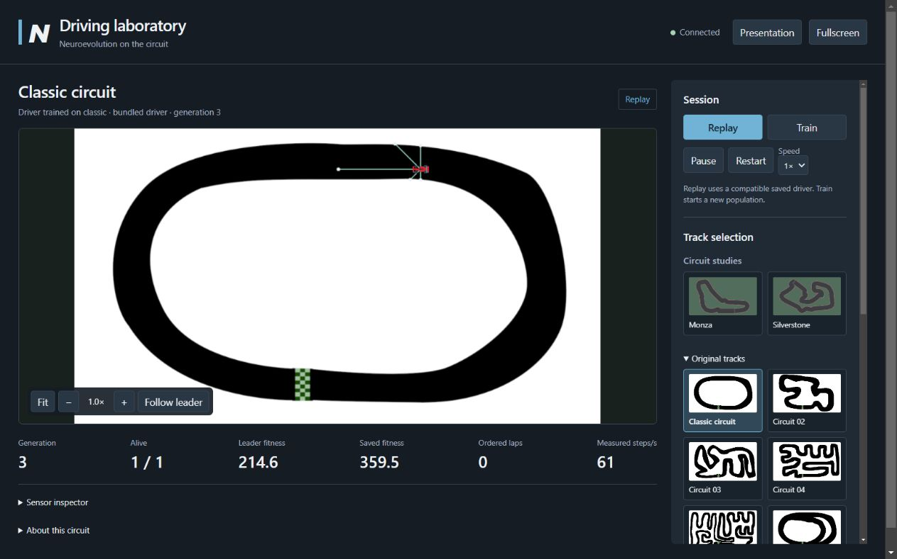

# NEAT Car Simulation

A local browser driving experiment for a live interview: replay a verified
Classic driver, watch a population learn, and inspect the five sensors behind
its four driving choices. Python owns physics and NEAT evolution; the browser
draws the track and controls the session. No online service is needed after setup.


## Start on Windows

1. Download or clone the repository and extract it into a normal folder.
2. On a new computer, install **Python 3.10–3.13**, then double-click
   **Setup.bat**. It creates a project `.venv` and installs three pinned libraries:
   Pygame 2.6.1, neat-python 0.92, and aiohttp 3.14.5. Setup needs internet access.
3. Double-click **Launch.bat**. The launcher waits for the local server and opens
   the default browser. Classic saved replay starts immediately on a fresh install.
4. Click **Stop server** when finished. Closing the tab alone leaves the simulation
   running. Launch again to start a fresh server after stopping.

The launcher checks the project environment, then common Python/Anaconda
installations. It does not depend on the author's folder path. Python 3.14 is
excluded by the pinned Pygame setup. If launch fails, run Setup and read the two
attempt logs named in the error under `logs/`.

The service binds only to `127.0.0.1`, usually at port 8765. If another app owns
that port, it chooses an available port and opens the actual URL. A second launch
reuses a verified ready server for this checkout, preserving its session. Reload
reconnects to the current session. Connection status is visible, and simulation
commands are disabled while disconnected. Multiple tabs share one server session.

For a terminal launch, or on another platform:

```sh
python -m venv .venv
# Windows: .venv\Scripts\activate
# macOS/Linux: source .venv/bin/activate
python -m pip install -r requirements.txt
python server.py
```

`python server.py --help` lists `--port PORT`, `--no-browser`, and
`--identity-file PATH`. `--port 0` lets the OS choose a port. Windows diagnostics,
run from the project folder:

```powershell
powershell.exe -NoProfile -ExecutionPolicy Bypass -File scripts/launch.ps1 -CheckOnly
powershell.exe -NoProfile -ExecutionPolicy Bypass -File scripts/launch.ps1 -NoBrowser -Port 0
```

The server and tests were exercised on Windows with Python 3.12.7. Other platforms
have not been verified here. A native Pygame fallback remains: `python app.py`,
or `python app.py --mode replay --track classic --color red`. It has its own menu
and keyboard controls; the browser is the default launcher experience.

## A ready-to-show driver

Classic's bundled driver was trained with seed 7 and selected at generation 3.
Fresh verification confirms it survives **1,200 steps**, covers the circuit
instead of circling in place, and has distance fitness about **359.5**. An episode
is nominally 20 seconds at 60 steps/s; actual time depends on throughput. Replay
loops when an episode ends. A compatible local Classic save can take precedence.



Monza and Silverstone are **circuit studies**. They start live training when no
compatible local champion exists. Both completed a genuine NEAT generation and
independent saved replay during verification; those early champions crashed with
zero laps. No successful GP lap champion is bundled or claimed.

## Controls and Advanced experiments

| Control | Effect |
| --- | --- |
| Track preview | Compatible replay if available, otherwise live training |
| Replay / Train | Explicitly select a compatible driver or start a fresh population |
| Pause / Restart | Freeze the simulation or restart the current mode and preset |
| 1× / 4× | Request 60 / 240 fixed physics steps per second |
| Car colors / custom color | Change appearance while preserving progress |
| Show leader sensors / Sensor inspector | View five rays, normalized inputs, and action |
| Checkpoints / Turn numbers / Sector colors | Independently show circuit-study overlays |
| Accent / Sensor opacity / Trail opacity | Adjust the interface and visual overlays |
| Fit / zoom / Follow leader | Change the camera without changing physics |
| Presentation / Fullscreen | Expand the view; Presentation works if fullscreen fails |
| Stop server | End the worker and release the listener |

Outside form controls, **Space** pauses, **R** restarts, **F** fits the track, and
**P** toggles presentation. Buttons support normal keyboard activation. Typing in
Advanced fields does not trigger simulation shortcuts.

Advanced is initially collapsed. Appearance changes apply immediately, including
**Reset appearance**. Browser storage remembers validated visual preferences only,
including ordinary car color, sensors, fit/follow mode and zoom; it does not store
driving/training presets. Road styling and width affect vector studies;
original bitmap roads stay as drawn.

Driving/training fields are **draft values** until **Apply and restart training**.
Opening Advanced, typing, or **Reset defaults in draft** does not change the active
session. Apply validates the draft on the server, starts fresh Train, and shows
acknowledged applied values. A reset draft still needs Apply. Restart alone uses
the current applied preset and seed.

| Experiment field | Default | Allowed range |
| --- | --- | --- |
| Max speed | 18 units/step | 6–24 |
| Steering | 5 degrees/step | 1–10 |
| Sensor range | 300 units | 100–600 |
| Road width (studies) | 120 units | 90–180 |
| Population | 30 | 10–100 |
| Random seed | 7 | 0–2147483647 |
| Episode limit | 1,200 steps | 300–3,600 |

## Tracks, rewards, and compatibility

There are two vector studies and 11 original bitmap tracks. Data in
`assets/circuits/` describes editable centerlines, turns, sectors and sources.
Monza's GP reference is 5.793 km / 11 turns; Silverstone's is 5.891 km / 18 turns.
These are **reference facts**, not measured simulation lengths or exact geometry.
See the [Monza reference](https://www.formula1.com/en/latest/article/circuit-guide-everything-you-need-to-know-about-the-autodromo-nazionale-monza.51PKqBRlxNs0fzLWQzsnd0.51PKqBRlxNs0fzLWQzsnd0)
and [Silverstone reference](https://www.formula1.com/en/latest/article/circuit-guide-everything-you-need-to-know-about-silverstone-2026.5Sl0O8g393enBWVIkjRzOr),
reviewed October 10, 2026.

The studies are original educational schematics informed by reference maps,
not surveyed geometry or official artwork. Monza's bends/chicanes use a wider
road envelope for the simplified car. Silverstone's inner loop and northern
hairpin were opened, and its outer right section spaced outward, to separate
road stretches at the 90/120/180-unit presets. Visible roads and collision masks
use the same sampled centerline and width. Kerbs and labels are decoration.

Each car feeds five wall distances at −90°, −45°, 0°, +45°, +90°, divided by the
sensor range, into a feed-forward network. Its largest output chooses left,
right, brake, or accelerate. Default braking bottoms out at 6 units/step and
acceleration is capped at 18. Movement uses collision substeps; image boundaries
are walls. Camera scaling does not change simulation coordinates.

Original tracks retain **fitness = distance travelled / 60**, which can reward
circling. Study fitness rewards forward **ordered checkpoints**, with bounded
partial progress. A finish crossing counts a lap only after preceding gates;
reversed, repeated, and out-of-order crossings do not accumulate checkpoint
credit. Cars stop after 600 steps without an accepted checkpoint. Episodes also
end when all cars crash or the configured step limit is reached. NEAT then
selects, reproduces and speciates the next generation. Compare fitness only
within the same track and experiment: distance and checkpoint scores differ.

Browser champions use numeric JSON format 2 at
`saved/experiments/<fingerprint>/<track>.json`. Compatibility requires the same
physics version, track, all seven applied settings (including seed, population,
episode limit and width), geometry revision and reward revision. Browser
experiments preserve both `demos/classic.json` and legacy `saved/<track>.json`.
Format-1 drivers replay normally only on their original bitmap track with the
complete default preset. Corrupt/incompatible candidates are skipped; explicit
Replay reports when no compatible driver exists. **Restore compatible preset
and replay** deliberately adopts a saved driver's full preset.

**Test Classic driver here** is an explicit transfer experiment, requiring
matching max speed, steering, sensor range and road width. Its source training
track is labelled. Source saved fitness is not a target-track score. Transfer
does not prove the driver learned the target. A saved driver is an inference
network, not an evolutionary population checkpoint.

For headless **original-track** training:

```sh
python train.py --track classic --generations 30 --seed 7
```

This saves a legacy driver under `saved/`; use `--output <folder>` for another
destination. Study training and Advanced presets are available in the browser.
The legacy CLI lists bitmap IDs with `python train.py --help`.

## Architecture and verification

| File | Responsibility |
| --- | --- |
| `server.py` | Loopback HTTP commands, WebSocket snapshots, worker and launch/shutdown |
| `runtime.py` | Modes, validated commands, compatibility and detached snapshots |
| `web/` | Canvas rendering, camera, browser controls and visual preferences |
| `settings.py`, `models.py` | Presets, fingerprints and numeric driver files |
| `circuits.py`, `progress.py`, `tracks.py` | Geometry, masks, gates and track registry |
| `simulator.py`, `training.py` | Sensors/actions/collisions and real Python NEAT evolution |
| `app.py`, `train.py`, `scripts/` | Native fallback, legacy CLI and Windows helpers |

HTTP commands are acknowledged before applied values change. WebSockets carry
snapshots; all simulation mutations run on one worker. Canvas interpolates only
within the same episode, separately from fixed physics steps. Assets/system fonts
are local; online reference links open only when clicked.

```powershell
$env:SDL_VIDEODRIVER='dummy'
$env:SDL_AUDIODRIVER='dummy'
$env:PYGAME_HIDE_SUPPORT_PROMPT='1'
python -m unittest discover -s tests
```

The current suite passed **89 tests** on October 12, 2026: legacy behavior,
genuine generation/replay, settings/save isolation, geometry/gates, transport
lifecycle/security, simultaneous process launch reuse and actual Windows launcher
reuse through a directory junction. The two Node checks in `tests/web_app.mjs` and
`tests/web_visuals.mjs` also passed for appearance persistence and rendering.
Actual browser checks covered replay/training, controls, draft apply/reset,
reload, responsive layout and Stop. Observed simulation samples were 60–61 steps/s
at 1× and 227 at 4×, not guarantees. Rendering frame rate was not measured.
Successful OS fullscreen remains a manual check: the scripted browser rejected
it and Presentation worked. See [verification evidence and limits](docs/VERIFICATION.md)
and the [two-minute interview walkthrough](docs/INTERVIEW.md).

## Project origin and later artwork

This extends the **NeuralNine / Cheesy AI car simulation**, not an independently
invented driving algorithm. Starting code/assets came from
[NeuralNine/ai-car-simulation](https://github.com/NeuralNine/ai-car-simulation).
Its [source](https://github.com/NeuralNine/ai-car-simulation/blob/master/newcar.py)
credits Cheesy AI for inspiration and Florian Dedov (NeuralNine) for the tutorial.
AI assistance was used for the presentation, browser, simulation, tests and
documentation. [ATTRIBUTION.md](ATTRIBUTION.md) preserves verified asset matches
and third-party license context.

Existing sprites remain. Omar will manually choose actual top-down F1 artwork
later. Record each artist/source and permission before adding assets. The
renderer separates rotation anchor, display size, heading offset and collision
dimensions so artwork can change without silently altering driving behavior.
This is a flat learning demo with simplified dynamics, not realistic racing or
a general-purpose driver.
