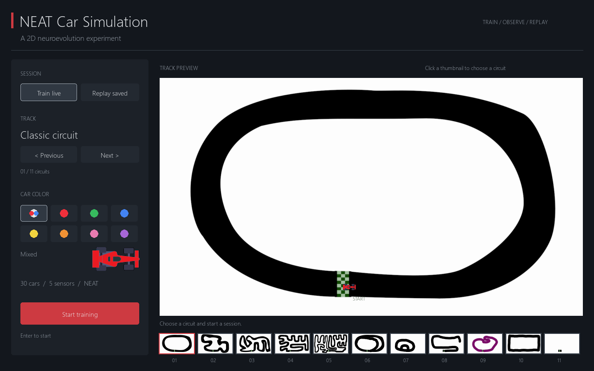
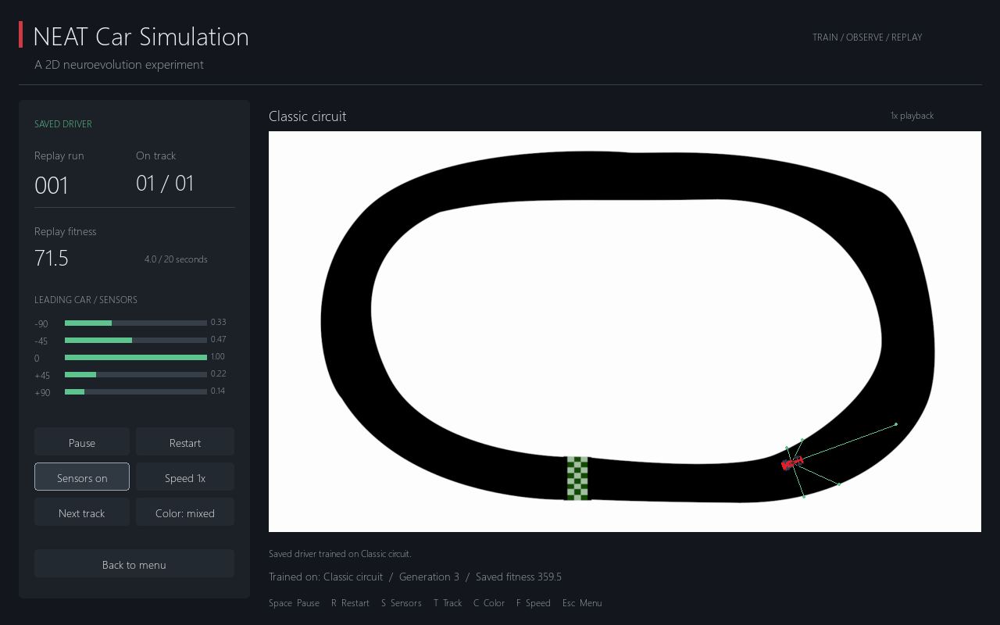

# NEAT Car Simulation

A small 2D driving experiment prepared for a live interview demo: choose a
circuit, watch a population learn, or replay a saved driver. Built with Python,
Pygame, and NEAT. The simulation runs locally and needs no online service.



## Project origin

This project is an extension of the **NeuralNine / Cheesy AI car simulation**,
not an independently invented driving algorithm. The starting code and assets
come from the tutorial project
[NeuralNine/ai-car-simulation](https://github.com/NeuralNine/ai-car-simulation).
Its [original source](https://github.com/NeuralNine/ai-car-simulation/blob/master/newcar.py)
credits **Cheesy AI** for inspiration and **Florian Dedov (NeuralNine)** for
the tutorial implementation. See [ATTRIBUTION.md](ATTRIBUTION.md) for the
verified asset matches and provenance details.

The original experiment supplied the bitmap tracks, five wall-distance sensors,
four driving actions, and NEAT population. This version adds a presentation menu,
track previews, color controls, pause/restart, visible sensors, a Windows launcher,
driver export/replay, boundary handling, capped speed, and regression checks.
AI assistance was used for this presentation upgrade and its tests and documentation.

## Start on Windows

1. Download or clone the repository and extract it into a normal folder.
2. On a new computer, install **Python 3.10–3.13**, then double-click `Setup.bat`.
   Setup creates `.venv` and installs the two pinned libraries. Internet access is
   needed only during setup.
3. Double-click **`Launch.bat`**. Pick a track and car color, then select
   **Train live** or **Replay saved**.

The launcher first checks the project environment, then common Python/Anaconda
installations. It never depends on a particular user's absolute folder path.
If the compatible libraries are already installed in Anaconda, setup is optional.
Python 3.14 is excluded because this version pins an earlier Pygame release.

On other platforms, use a virtual environment:

```sh
python -m venv .venv
# Windows: .venv\Scripts\activate
# macOS/Linux: source .venv/bin/activate
python -m pip install -r requirements.txt
python app.py
```

The application and tests have been exercised on Windows with Python 3.12.7,
Pygame 2.6.1, and neat-python 0.92. Other platforms use the same Python entry point;
the Windows launch scripts are platform-specific.

## A ready-to-show driver

Select **Classic circuit → Replay saved** for the bundled driver. It was actually
trained with seed 7, selected at generation 3, and survived all 1,200 simulation
steps in verification (20 seconds at normal playback). Its saved fitness is
approximately 359.5. It loops automatically after an episode ends.



Local training automatically saves each improved generation winner under
`saved/<track>.json`. Replay prefers a local save for the selected track; otherwise,
it uses the bundled classic driver. The interface displays the training track and
marks replay on a different circuit as a **transfer test**. Success on one track
does not establish success on every track. A saved driver is an inference network,
not a checkpoint for resuming an evolutionary population.

## Controls

| Control | Action |
| --- | --- |
| Mouse | Select tracks, colors, mode, and session buttons |
| Enter | Start from the menu |
| Left / Right | Previous / next track in the menu |
| Space | Pause / resume |
| R | Restart the selected session |
| S | Toggle the leading car's sensor rays |
| T | Next track; starts a new session |
| C | Cycle colors; preserves driving/training progress |
| F | Toggle 1× / 4× playback |
| Esc | Return to menu; press again to quit |

The 11 thumbnails use the existing images, including a small practice/test map.
Mixed color cycles through the seven existing sprites. Color has no effect on
the neural network. Restarting training uses the same seed by default, making
early generations reproducible. The 4× control advances four fixed steps per
displayed frame; it changes playback speed, not the driving model.

## How the experiment works

Each generation starts 30 cars on the selected track. Each car measures five rays
at −90°, −45°, 0°, +45°, and +90° relative to its heading, with a maximum range of
300 image pixels. The five distances are divided by 300 and supplied to a
feed-forward network. The largest of four outputs chooses:

| Output | Action |
| --- | --- |
| 0 | Turn left by 5° |
| 1 | Turn right by 5° |
| 2 | Brake, down to 6 pixels per step |
| 3 | Accelerate, up to 18 pixels per step |

Cars collide with near-white pixels or the image boundary. Movement is checked
in small substeps to avoid jumping through a wall. Rendering is scaled to the
window; collisions and sensors always use the original image coordinates.

**Fitness = distance travelled / 60.** Fitness is assigned from the total distance
once, rather than repeatedly adding the entire travelled distance each frame.
An episode ends when all cars crash or after 1,200 steps. NEAT then selects,
mutates and speciates the next generation using `config.txt`.

This is a learning demonstration, not realistic vehicle dynamics. Fitness does
not measure laps or ordered checkpoints and can reward repeated driving in a
small region. Sensors contain no camera perception or speed input; walls are
sampled from a bitmap. Those are useful limitations to discuss in an interview.

## Prepare another driver

```sh
python train.py --track classic --generations 30 --seed 7
python app.py --mode replay --track classic --color red
```

`train.py` runs without a display and saves the best driver to `saved/`.
Other track IDs: `track02`, `track03`, `track04`, `track05`, `track07`,
`track08`, `track09`, `purple`, `rectangle`, `practice`.
Use `--output <folder>` to save training results elsewhere.

Drivers are numeric JSON files with a format version, physics version, training
track, generation, seed and fitness. Loading reconstructs only the supported
feed-forward network. Incompatible or malformed files show an error in the menu.

## Code and verification

| File | Responsibility |
| --- | --- |
| `app.py` | Pygame menu, rendering and presentation controls |
| `simulator.py` | Car movement, collision, sensors and actions |
| `tracks.py` | Track files and start positions |
| `training.py` | Incremental evaluation and NEAT generation lifecycle |
| `models.py` | Versioned JSON driver export and loading |
| `train.py` | Headless training entry point |
| `scripts/` | Windows setup and launch helpers |

```sh
python -m unittest discover -s tests -v
```

The tests cover boundary handling, safe starts on every track, speed limits,
fitness, deterministic restart, driver serialization, actual training/replay,
pause, track/color changes and mouse input at a resized window.
Every track has also completed a real generation in the local smoke check.

For a quick rehearsal and interview questions, read
[docs/INTERVIEW.md](docs/INTERVIEW.md).

## Later: F1 car artwork

The current car sprites are preserved. Replacing them with manually chosen
top-down F1 artwork is a later addition, to be selected with the project owner.
No new car artwork or team logos are included in this upgrade. Future sprites
should face right, have a transparent or black background, and include their
source/permission in the attribution file. Changing the visual sprite alone
will not change the collision model.
