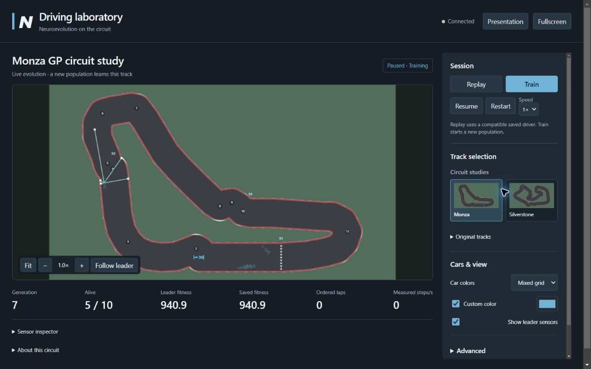

# Browser verification evidence

Release preparation on Windows, October 12, 2026. These notes distinguish fresh
release checks from earlier actual browser and launcher observations on the same
implementation. They do not claim a successful GP champion lap or guaranteed rates.

## Fresh release checks

Python 3.12.7; Pygame 2.6.1, neat-python 0.92, aiohttp 3.14.5. With dummy SDL video
and audio, `python -m unittest discover -s tests` passed **89 tests in 40.754s**
after the final review fixes (the preceding release pass was 86 in 27.068s).
This includes the Classic 1,200-step survival/coverage test, actual generation
and compatible saved replay for both studies, legacy/native tests, geometry/gates,
settings/save isolation, transport security/lifecycle, and real Windows PowerShell
simultaneous launches through a directory junction. Two synchronized independent
Python processes also reused one worker/session with port 0, a free preferred
port, and an occupied preferred port; distinct identity mirrors agreed, Stop
terminated both processes and released the listener. Startup failure, process
death and cancellation while waiting released the checkout lock. Non-Windows environments can skip
the Windows-specific launcher regression.

`node tests/web_visuals.mjs` and `node tests/web_app.mjs` passed with Node 24.19.0.
These deterministic checks cover independent checkpoints/turns/sectors, unchanged
asphalt geometry, accent/opacity, safe preference migration/storage denial,
ordinary palette/sensors and camera persistence, one initial appearance restore
without acknowledgement/reconnect loops, and leader pose/rays plus trail reset
on handoff (normal, paused and reduced motion).

An additional fresh bounded run independently loaded each saved champion and
drove a new Car. Study settings: population 10, seed 7, episode limit 300, speed
18, steering 5°, sensor range 300, road width 120. Each generation used actual
NEAT evaluation, reproduction and speciation; each champion was format 2.

| Circuit | Generation evaluation ticks | Saved generation | Saved fitness | Independent replay steps | Replay laps | Replay alive |
| --- | --- | --- | --- | --- | --- | --- |
| Monza | 133 | 1 | 609.211012 | 133 | 0 | No |
| Silverstone | 67 | 1 | 299 | 64 | 0 | No |

Both sessions advanced to generation 2. These experimental champions are evidence,
not bundled deliverables. Classic's bundled driver remained alive at 1,200 steps,
fitness 359.533333, covering x=238.10–1695.24 and y=147.28–950.00 simulation units.
Classic uses distance fitness; study checkpoint scores are not comparable to it.

## Actual browser observations retained from interface verification

Chrome checks used the allowed computer-use browser surface, with a real local
Python server. Screenshots below are actual captures of the running interface.

- Default Classic bundled replay, keyboard Pause, color changes, 1×/4× selection,
  and live study training worked. Samples showed **60–61 steps/s at 1×** and
  **227 steps/s at 4×**; requested targets are 60/240. Paused samples were zero.
  Rendering frame rate was not measured.
- During paused Monza training, editing width/population and typing `r` in the
  seed field preserved session, episode and cars. Apply acknowledged width
  150/population 10, created a new training session, and refreshed the road
  catalog to the same width. Reset defaults in draft left the active session alone.
- Sensors/inspector, zoom, Fit, Follow leader and Presentation were exercised.
  At a 390×844 requested viewport, document client/scroll widths matched with no
  horizontal page overflow. Capture dimensions may omit scrollbar/browser chrome.
- Reload reconnected to the same paused session/episode and kept the custom visual
  preference. Real WebSocket integration tests separately covered disconnect and
  reconnect to an existing session; no claim of a forced browser network-outage
  test is made.
- Incompatible Classic Replay reported an error and offered Restore compatible
  preset and replay. Restoration returned the bundled generation-3 Classic driver
  and its default preset. Explicit Classic-on-Silverstone transfer identified
  source track, bundled source and source fitness separately; it showed zero laps.
- Stop server showed Server stopped, disabled commands and terminated the server.
  Browser console checks reported no errors/warnings at startup and final checks.

[Classic replay](browser-classic-1280.jpg) · [Narrow layout](browser-narrow-390.jpg) ·
[Follow camera](browser-follow.jpg) · [Presentation](browser-presentation.jpg)

The final appearance fix wave also retained actual Chrome captures of independent
[checkpoints](browser-checkpoints.jpg), [sector colors](browser-sector-colors.jpg),
and [restored appearance/camera](browser-appearance-restored.jpg). Paused server
snapshots before and after the appearance changes preserved session, episode,
generation, settings, fingerprint, car position and sensor geometry; palette and
sensor visibility changed. These captures and snapshots were recovered from the
interrupted verification run, not repeated during the final test continuation.

## Actual launcher observations retained from launcher verification

The actual `Launch.bat` was invoked through a hidden command host in an isolated
folder containing spaces. First launch succeeded, a second preserved the same
session/URL, Stop removed the identity, and relaunch produced a new ready session.
No native SDL simulation window appeared. An unrelated occupied preferred port,
stale records and wrong application/protocol/checkout identities were also checked
with real sockets in tests. The current suite includes the later canonical-path
fix and actual Windows PowerShell 5 launches twice through a directory junction.

Default OS browser dispatch succeeded, but its tab was not exposed in the connected
Chrome profile. A separate allowed Chrome navigation showed the ready rendered
simulation. Native desktop APIs were unavailable, so this was an actual batch
invocation, **not a literal Explorer double-click**, and the OS-selected browser
tab was not inspected. Setup completed successfully with the three pinned
libraries. Pip emitted temporary-directory cleanup warnings; their cause was not
established. No manual OS cleanup or global settings changes were made.

## Verification limits

- Scripted Chrome rejected Fullscreen; the message and Presentation fallback were
  verified. Successful real OS fullscreen remains a manual check.
- Malformed/missing/denied browser storage was checked using the actual preferences
  module with isolated storage substitutes: six fallback cases, valid color
  roundtrip, visual-only persistence and unavailable-storage load/save passed.
  It was not tested by mutating this browser's storage.
- Local-only assets, module imports, requests, fonts and WebSocket URLs were audited
  in source. No offline network-interception test was performed. Online circuit
  references are user-activated links. Reduced-motion gating was reviewed in code,
  not by changing the user's OS settings.
- Other operating systems and rendering frame rate remain unverified. Performance
  samples describe this machine and run, not minimum guarantees.
- Circuit roads are educational schematics with documented spacing/width changes.
  Five rays and simplified 2D physics do not establish realistic or general driving.
  Actual F1 artwork remains a later manual selection with provenance recorded.
